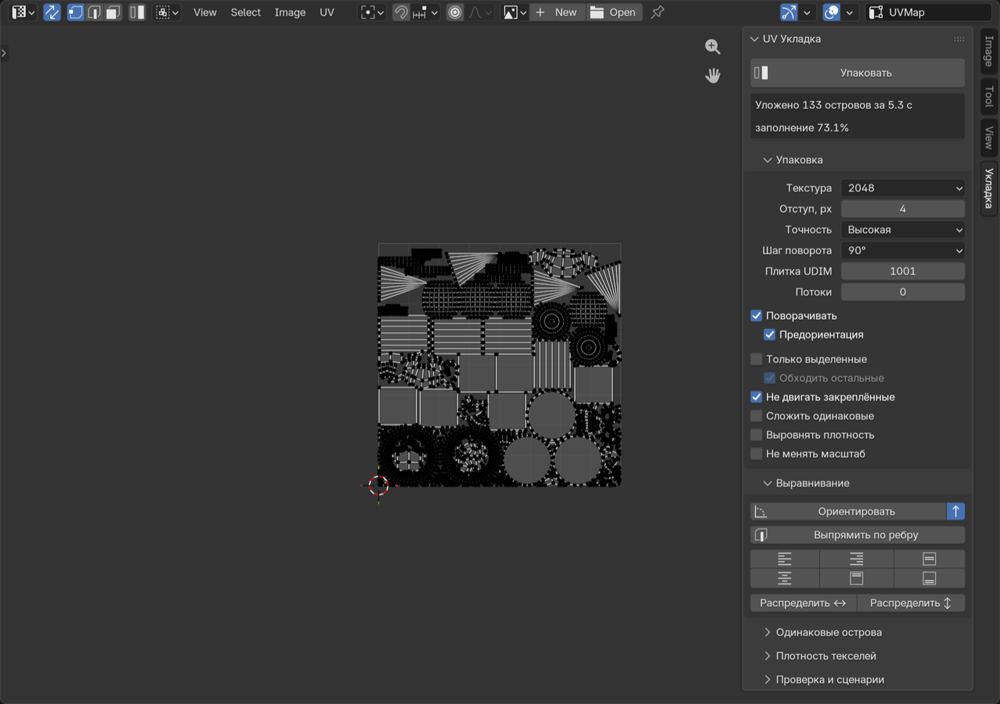

# UV Укладка — упаковка UV-островов для Blender

Аддон (extension) для Blender 4.2+ (проверен на 5.2): плотная упаковка UV-островов
по их настоящей форме, выравнивание, сложение одинаковых островов, плотность
текселей, проверка развёртки и сценарии на Python.

**Скачать:** [uv_ukladka-1.0.0.zip](https://github.com/volik1987/uv-ukladka/releases/latest/download/uv_ukladka-1.0.0.zip)
(страница релизов — [Releases](https://github.com/volik1987/uv-ukladka/releases)).



## Установка

1. Скачайте `uv_ukladka-1.0.0.zip` (или соберите: `./build.sh` → `dist/`).
2. Blender → Edit → Preferences → Get Extensions → ⌄ → **Install from Disk…** → выберите zip.
3. UV Editor → боковая панель (N) → вкладка **«Укладка»**. Кнопка «Упаковать» есть и в меню UV.

## Возможности

**Упаковка**
- Плотная укладка по форме острова, а не по рамке: острова вкладываются друг в друга, в вырезы и «дырки».
- Повороты с шагом 90° / 45° / 30° / 15° и предварительный поворот острова к минимальной рамке.
- Отступ в пикселях текстуры (512…8192), он же соблюдается и от краёв плитки.
- Точность: «Быстро» / «Обычная» / «Высокая» (перебор порядков укладки) / «Максимум» (сетка 1024).
- Все ядра CPU: от 300 островов пробы идут в отдельных процессах Python (у каждого свой GIL),
  для мелких задач — в потоках. Поле «Потоки» — сколько проб одновременно (0 — авто, до 8).
- «Только выделенные» + «Обходить остальные» — уложить новые острова в свободное место вокруг уже разложенных.
- Закреплённые (pin) острова остаются на месте, остальные укладываются вокруг них.
- «Сложить одинаковые» — копии (массивы, дубликаты) кладутся друг на друга и занимают место один раз.
- «Выровнять плотность» — перед упаковкой острова получают одинаковую плотность текселей.
- «Не менять масштаб» — только переставить острова.
- Упаковка в любую плитку UDIM (1001…1100).
- Работает с несколькими объектами сразу, в режиме правки и в объектном режиме.

**Выравнивание**: ориентировать острова к минимальной рамке, выпрямить по выбранному ребру,
выровнять по краю/центру, распределить с равными промежутками.

**Одинаковые острова**: выделить одинаковые, сложить одинаковые (с допуском).

**Плотность текселей**: измерить, задать (px/м), уравнять у выделенных островов.

**Проверка**: процент заполнения плитки, перекрытия (выделяются), острова за пределами плитки.

**Сценарии на Python**: в панели «Проверка и сценарии» выберите текст из текстового редактора
и запустите — в нём доступен модуль `ukl`:

```python
isl = ukl.islands()                      # все острова: pts, area3d, area_uv, selected, pinned…
for i in isl:
    if i.area3d > 1.0:
        i.scale(1.5)                     # rotate(rad), transform(M, t), texel(2048)…
ukl.commit()
print(ukl.pack(margin_px=4, texture=4096, rot_step=45, stack=True))
print(ukl.check())                       # заполнение, перекрытия, за плиткой
```

Кнопка с листком создаёт пример сценария. Из своих скриптов: `from bl_ext.user_default.uv_ukladka import api as ukl`.

## Как это устроено

Каждый остров растеризуется в маску на сетке: клетки, которых касается остров (центры внутри
треугольников + рёбра), и проверочная маска, расширенная на отступ. Маски раскладываются
«снизу-слева» в полосу заданной ширины: сначала ищется место, где свободна вся рамка острова
(интегральное изображение), затем точная форма проверяется FFT-корреляцией только в полосе ниже —
так острова заходят в вырезы и дырки соседей. Ширина полосы и порядок укладки подбираются
параллельными пробами; итоговый масштаб — по стороне квадрата max(ширина, высота).
Только numpy, без внешних зависимостей и без GPU.

Замеры (Mac, 12 ядер, отступ 4 px на 2048): 133 острова — 2 с, заполнение 72%
(встроенная упаковка Blender «Concave» — 35 с, 62%); 7887 мелких островов — ~60 с.

## Тесты

```sh
./tests/run_tests.sh
```

Ставит zip в чистый профиль Blender и проверяет: нет перекрытий (по сетке 2048), всё внутри плитки,
плотность не хуже встроенной упаковки Blender (Concave), UDIM, «не менять масштаб», упаковку вокруг
невыделенных, сложение копий, выравнивание, тексели, проверку, сценарии, объектный режим, скорость
на ~1000 островов.

Лицензия GPL-3.0-or-later.
